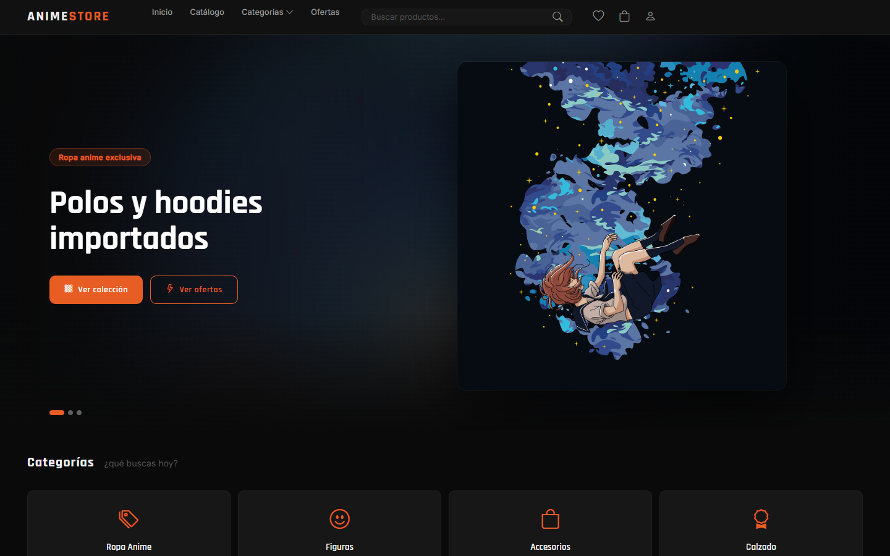
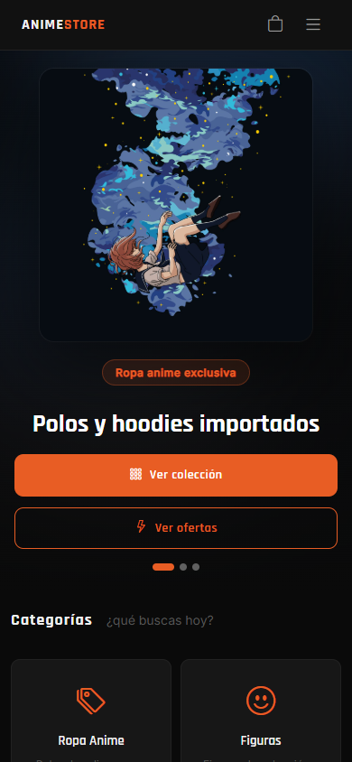
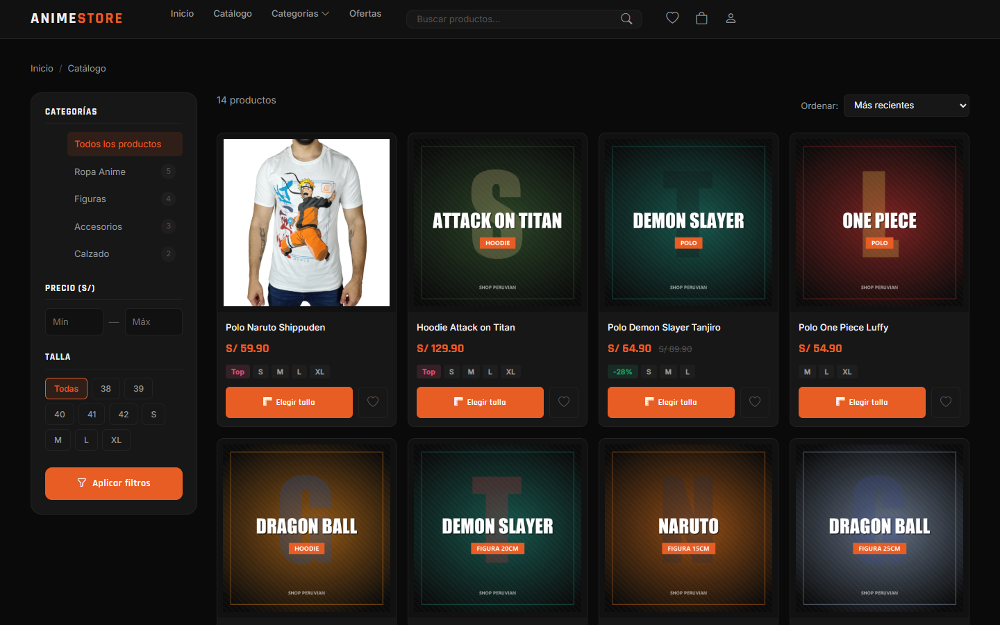

# Anime Store

Tienda online de ropa y accesorios de anime para Perú. Los clientes filtran el catálogo por categoría, precio y talla, guardan favoritos, aplican cupones y pagan con Yape subiendo su comprobante. La tienda gestiona productos, pedidos, cupones, banners y usuarios desde un panel de administración.



## Funcionalidades

**Tienda**
- Portada con banners, categorías y ofertas.
- Catálogo con filtros por categoría, rango de precio y talla, y orden por novedad o precio.
- Ficha de producto con varias imágenes, tallas y reseñas de clientes.
- Carrito, lista de deseos y cupones de descuento.
- Checkout con dirección de envío por departamento y provincia, y coste de envío.
- Pago con Yape: el cliente sube la captura del pago y la tienda la revisa.
- Registro, inicio de sesión (contraseñas cifradas) y "Mi cuenta" con el historial de pedidos.
- Instalable como aplicación en el móvil (PWA).

**Panel de administración** (`/admin`)
- Pedidos con filtro por estado y revisión del comprobante de Yape.
- Productos, categorías, cupones, banners de la portada y usuarios.

## Tecnologías

| | |
|---|---|
| Backend | PHP 8 sin framework, MySQLi, API interna en JSON (`/api`) |
| Frontend | HTML, CSS, JavaScript, Bootstrap 5, Bootstrap Icons |
| Base de datos | MySQL |
| Rutas | URLs limpias con `.htaccess` (mod_rewrite) |

## Capturas

| Móvil | Catálogo |
|---|---|
|  |  |

## Instalación local

1. Clonar el repositorio en la carpeta del servidor web (Laragon, XAMPP…), con `mod_rewrite` activo:
   ```bash
   git clone https://github.com/MarcoAfHz/anime-store.git
   ```
2. Crear una base de datos MySQL e importar `database/anime_store.sql`.
3. Revisar la conexión en `config/database.php` y los datos de la tienda en `config/config.php`. La URL base se detecta sola.
4. Abrir la web y entrar al panel en `/admin`.
